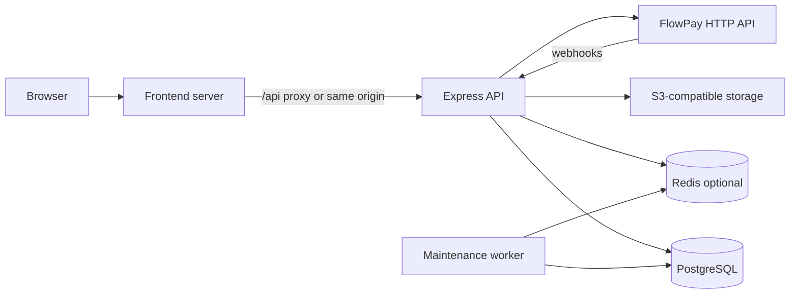

# ROBLYNE production architecture

This document reflects the **verified** implementation in the `Roblyne` workspace as of the production-readiness engineering pass. Assumptions are called out explicitly.

## System overview

ROBLYNE (package name `@workspace/evenum` for the web UI) is a **pnpm monorepo** with:

| Service | Location | Production entry |
|--------|----------|------------------|
| **Frontend** | `artifacts/roblyne/` | `node artifacts/evenum/server.mjs` (after `pnpm --filter @workspace/evenum run build`) |
| **API** | `artifacts/api-server/` | `node --enable-source-maps artifacts/api-server/dist/index.mjs` |
| **Background worker** | `artifacts/api-server/src/worker.ts` → `dist/worker.mjs` | `node --enable-source-maps artifacts/api-server/dist/worker.mjs` |

Shared libraries: `lib/db` (Drizzle + PostgreSQL), `lib/api-zod`, `lib/api-client-react`, `lib/api-spec`.

## Service responsibilities

### Frontend (`@workspace/evenum`)

- React 19 + Vite SPA; PWA plugin present.
- Dev: Vite proxies `/api` to `LOCAL_API_ORIGIN` (default `http://127.0.0.1:8080`).
- Production: static assets + `server.mjs` for SSR link previews (OG metadata) when configured.
- **Does not** talk to PostgreSQL or Redis directly.

### API (`@workspace/api-server`)

- Express 5 application (`src/app.ts`, `src/index.ts`).
- **Authentication:** email/password, bcrypt; **sessions in PostgreSQL** via `connect-pg-simple` (not JWT-first, not Redis sessions).
- **Authorization:** route middleware (`auth`, `orgAccess`, `platformAdmin`).
- **Domains:** events, elections, campaigns, organizations, payments/FlowPay, financial/settlements, admin, uploads, discover/search.
- **Synchronous by design:** vote recording, registrations, payment intent creation, webhook verification, eligibility checks.
- **Health:** `GET /api/healthz` (liveness), `GET /api/readyz` (DB + optional Redis/queue), `GET /api/metrics` (Prometheus text).
- **Maintenance scheduling:** on startup, the API instance that holds Redis scheduler lock `evenum:maintenance:scheduler-lock` registers BullMQ repeatable job `lifecycle-sweep` when `REDIS_URL` is set (`INSTANCE_ID` optional for lock ownership).
- **Discover cache invalidation:** catalog writes and lifecycle sweeps call `invalidateDiscoverCache()` (Redis `SCAN` + `DEL` on `evenum:discover:v2:*`).
- **In-process lifecycle fallback:** when Redis is absent. Production automatically assigns lifecycle processing to the worker when Redis is configured (see `src/index.ts`).

### Background worker (`dist/worker.mjs`)

- **Verified job:** `lifecycle-sweep` on queue `evenum-maintenance` → `sweepExpiredLifecycles()` (elections → `ended`, campaigns → `ended`, published events past `endsAt` → `completed`).
- **Heartbeat:** Redis key `evenum:maintenance:worker:heartbeat` (TTL 45s); API `/api/readyz` uses this automatically in production when Redis is configured.
- **Health:** HTTP `WORKER_HEALTH_PORT` (default **8091**), paths `/healthz` and `/`.
- **Requires:** `REDIS_URL`, `DATABASE_URL` (via `@workspace/db` import in lifecycle sweep).
- **No email/notification jobs** — there is no mail provider in the codebase (verified by route/lib search).

## Communication and dependencies

| From | To | Mechanism |
|------|-----|-----------|
| Browser | Frontend | HTTPS |
| Browser | API | Same-origin `/api` or CORS with credentials |
| API | PostgreSQL | `pg` pool + Drizzle |
| API | Redis | `ioredis` (`src/lib/redis.ts`) — cache, rate limits, queue producer |
| Worker | Redis | BullMQ + heartbeat |
| Worker | PostgreSQL | Drizzle updates in lifecycle sweep |
| API | FlowPay | REST (`src/lib/flowpay.ts`) |
| API | S3 | AWS SDK (`src/lib/s3-image-storage.ts`) |

## Redis usage (verified)

| Use case | Implementation | Required for API? |
|----------|----------------|-------------------|
| BullMQ maintenance queue | `evenum-maintenance` | No (fallback sweep without Redis) |
| Rate limiting | Custom store on `express-rate-limit` prefixes `evenum:ratelimit:*` | No (per-process fallback map) |
| Discover cache | Keys `evenum:discover:v2:…`, TTL 10s | No (DB fallback) |
| Worker heartbeat | `evenum:maintenance:worker:heartbeat` | When Redis is configured in production |

When Redis is configured in production, readiness fails when Redis is unreachable. Cache/rate-limit failures degrade without blocking auth.

## PostgreSQL

- Schema in `lib/db/src/schema/`; migrations in `lib/db/drizzle/`.
- Session table managed by `connect-pg-simple` at runtime.
- Pool per process: `DATABASE_POOL_MAX` (default 5), configurable idle/connection timeouts in `lib/db/src/index.ts`.

## Operations that block API requests

- Discover/search ILIKE queries (mitigated: discover Redis cache + in-flight coalescing; search now bounded with `LIMIT`).
- Vote/register/campaign submit with DB transactions.
- FlowPay API calls during checkout (timeout capped via `FLOWPAY_TIMEOUT_MS`).
- Image upload presign + client PUT (metadata in API).

## Operations that should remain synchronous

- Vote success confirmation, payment webhook HMAC verification, idempotent financial writes, eligibility enforcement at vote time (see comments in `lifecycle.ts`).

## Scaling constraints (verified)

| Constraint | Detail |
|------------|--------|
| Sessions | PostgreSQL-backed — safe across API replicas |
| Rate limits | Without Redis, limits are **per API instance** |
| Lifecycle transitions | Without worker + Redis in production, scheduled status transitions may lag (request-time rules still apply) |
| Discover in-flight map | **Per-process** request coalescing (acceptable; Redis cache shares results across instances) |
| Repeatable BullMQ job | Registered from each API startup; uses fixed `jobId` `lifecycle-sweep` (BullMQ upserts repeat config) |

## FlowPay reference comparison (evidence-based)

FlowPay (`FlowPay/services/api`) **separates** API (`server.ts`) and worker (`workers/queue.worker.ts`) with:

- Multiple BullMQ queues (retry, webhook, charge) and richer job semantics.
- `addQueueJobSafely` + Redis circuit breaker when enqueue fails.
- Worker HTTP health on `WORKER_HEALTH_PORT`.

ROBLYNE currently has a **single maintenance queue** and no payment work on the worker (payments stay on API/webhooks). The deployment **pattern** (three processes) aligns; the **job surface area** is intentionally smaller.

## Replit deployment artifacts

- Web: `artifacts/roblyne/.replit-artifact/artifact.toml` → port 22244.
- API: `artifacts/api-server/.replit-artifact/artifact.toml` → port 8080, `/api`.
- **Worker is not a separate Replit artifact yet** — run as a third process/service on your host (documented in the deployment runbook).

## Related docs

- `SETUP.md` — local setup (still accurate for commands).
- `ROBLYNE_PRODUCTION_DEPLOYMENT_RUNBOOK.md`
- `ROBLYNE_ENVIRONMENT_VARIABLES.md`
- `ROBLYNE_SCALABILITY_AND_PERFORMANCE_REPORT.md`
